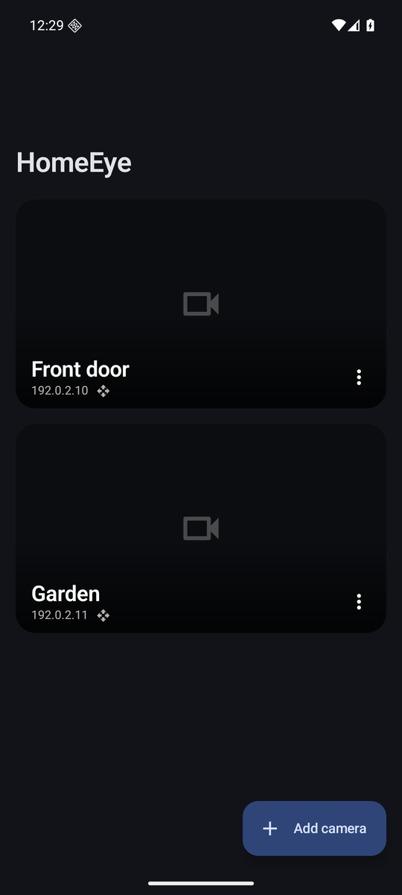
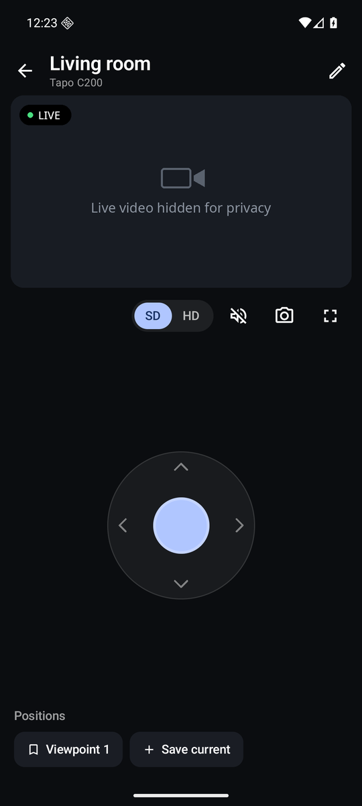
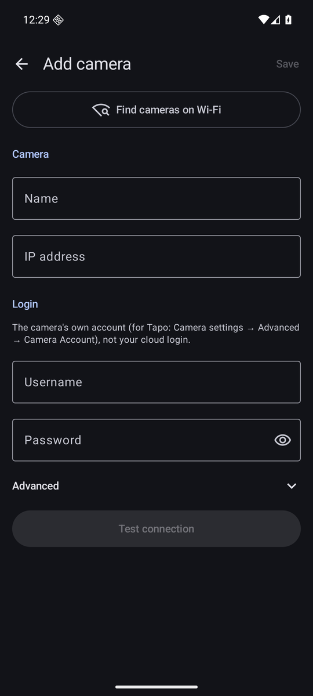

<div align="center">

# HomeEye

**A clean, local-only Android app for your IP cameras.**
Live video, pan/tilt and saved positions, with no cloud, no account and no trackers.

[](LICENSE)


 &nbsp;
 &nbsp;


</div>

---

## Why

Most camera apps send your video through the manufacturer's cloud, need an account and come packed with tracking. Most open-source viewers work, but they're clunky.

HomeEye talks **directly to your camera on your own Wi-Fi** using the open ONVIF and RTSP standards. You can even block your camera's internet access completely and everything keeps working.

## Features

| | |
|---|---|
| 🔍 **Find cameras automatically** | Scans your Wi-Fi for ONVIF cameras, with a direct-scan fallback for routers that block discovery |
| ✅ **Test before you save** | Shows model, firmware, stream resolutions and pan/tilt support, with clear errors like *"Wrong username or password"* |
| 📺 **Low-latency live view** | Small buffers for a near-live picture, automatic reconnect when Wi-Fi blips |
| 🕹️ **Joystick pan/tilt** | Drag to move, let go to stop. Reverse axes for ceiling mounts |
| 📍 **Saved positions** | Jump to, save and remove camera presets |
| 🔎 **Pinch to zoom** | Digital zoom and pan, double-tap to reset |
| 🖥️ **Fullscreen** | Landscape view with controls that fade away |
| 🎚️ **SD / HD switch** | Use the lighter stream on weak Wi-Fi |
| 📸 **Snapshots** | Saved to `Pictures/HomeEye` |

## Privacy

- **Only talks to your cameras.** HomeEye makes no other network connections: no analytics, no crash reporting, no update checks.
- **Encrypted logins.** Camera passwords are encrypted with a key held in the Android Keystore, which can't be read out of the device.
- **Never backed up.** App data is excluded from Google cloud backup and device-to-device transfer.
- **No Google Play Services**, no ads, no third-party SDKs beyond AndroidX and Media3.

> Android requires the `INTERNET` permission for *any* network access, including your home Wi-Fi. HomeEye only uses it for the cameras you add.

## Compatible cameras

Any camera with **ONVIF Profile S** (live streaming) should work. Pan/tilt needs ONVIF PTZ support.

| Camera | Status |
|---|---|
| TP-Link Tapo C200 | ✅ Tested: stream, pan/tilt, presets, discovery |
| Other Tapo, Reolink, Hikvision, Dahua, Amcrest, … | Should work. Please [report](../../issues) how it goes |

### Tapo setup

1. In the Tapo app, open the camera → **Settings → Advanced Settings → Camera Account**.
2. Create a username and password. This is the camera's own login, not your TP-Link account.
3. In HomeEye, tap **Find cameras on Wi-Fi** (or enter the IP), then use that login. Tapo's ONVIF port is `2020`.

**Keep the camera offline:** block its internet access in your router. HomeEye keeps working; only the Tapo cloud features stop.

## Install

Download the APK from [**Releases**](../../releases) and open it on your phone (allow installing from your browser or file manager when asked).

Requires Android 10 or newer.

## Build from source

You need JDK 17+ and the Android SDK (platform 36).

```sh
git clone https://github.com/cutamar/HomeEye.git
cd HomeEye
./gradlew :app:assembleDebug      # → app/build/outputs/apk/debug/
```

Release builds are unsigned unless you add a `keystore.properties` file (see `app/build.gradle.kts`).

### Project layout

```
onvif/   Plain Kotlin ONVIF client + camera discovery. No Android dependencies,
         so it's tested on a regular PC, including against a real camera.
app/     The Android app: Jetpack Compose UI, Media3 (ExoPlayer) for RTSP.
```

### Tests

```sh
./gradlew :onvif:test
```

To also run the tests against your own camera:

```sh
HOMEEYE_CAM_HOST=<camera-ip> HOMEEYE_CAM_USER=<user> HOMEEYE_CAM_PASS=<password> ./gradlew :onvif:test
# Add HOMEEYE_CAM_MOVE=1 to also nudge the camera right and back.
```

## Roadmap

- [ ] Multi-camera grid view
- [ ] Two-way talk
- [ ] Motion alerts (ONVIF events)
- [ ] Recording to phone storage
- [ ] F-Droid release

Ideas and pull requests welcome.

## License

[MIT](LICENSE)
